# Validryn: Combining ICM and Cerebras into an Evidence-to-Action Platform

## Direct Answer

The two articles should be combined as separate architectural layers inside Validryn, not blended into one retrieval chatbot. Cerebras supplies the **knowledge plane** that finds and normalizes relevant information; Interpretable Context Methodology (ICM) supplies the **workflow plane** that divides work into inspectable stages with explicit inputs, processes, and outputs.[^1][^2]

Validryn should provide the missing **control plane**: deterministic execution, schemas, state transitions, permissions, sandboxing, evidence lineage, verification, approval, and rollback. The result is an evidence-to-action platform where retrieved knowledge can inform work but cannot authorize actions.

## Combined Architecture

| Plane | Source | Validryn responsibility |
|---|---|---|
| Knowledge | Cerebras | Connectors, normalization, exact and semantic retrieval, rank fusion, reranking, source scopes, citations |
| Workflow | ICM | Numbered stages, `CONTEXT.md` contracts, selective context loading, references, editable artifacts |
| Control | Validryn | State machine, policy enforcement, execution backends, schemas, hashing, provenance, retries, approvals |
| Learning | Validryn extension | Episodes, corrections, lesson proposals, held-out validation, promotion, retirement, rollback |
| Experience | Validryn extension | CLI first; later a review UI for evidence, diffs, tests, decisions, and run comparison |

Cerebras uses multiple retrieval views because exact tokens, paraphrases, rare terms, and freshness require different signals. It fuses candidates, deduplicates sources, reranks them against the question, and expands surrounding context only after ranking. ICM uses numbered stage folders, layered context, and stage contracts so one agent can load only the references and working artifacts needed for the current job.[^3][^2][^1]

## System Flow

```mermaid
flowchart LR
    T[Task] --> W[Versioned workflow]
    W --> C[Stage contract]
    C --> Q[Scoped query plan]
    Q --> K[Knowledge tools]
    K --> E[Versioned evidence bundle]
    E --> M[Model proposal]
    M --> V[Deterministic validation]
    V --> X[Restricted execution]
    X --> R[Human review]
    R --> D[Approved or rejected decision]
    D --> P[Recorded episode]
    P --> L[Lesson proposal]
    L --> G[Evaluation and approval gate]
    G --> A[Versioned approved memory]
    A --> Q
```



The important trust boundary is between evidence and instructions. Repository files, messages, documents, logs, and tool outputs can contain indirect prompt injections, so Validryn must treat retrieved material as untrusted data, separate it from workflow instructions, restrict available actions, and require confirmation for consequential operations.[^4][^5]

## Workflow Structure

ICM should become Validryn’s human-readable workflow authoring format, while YAML or JSON becomes the machine-enforced representation.

```text
validryn/
├── workflows/
│   └── failing-test/
│       ├── CONTEXT.md
│       ├── workflow.yaml
│       ├── references/
│       │   ├── evidence-policy.md
│       │   ├── patch-policy.md
│       │   └── review-policy.md
│       └── stages/
│           ├── 01_capture/CONTEXT.md
│           ├── 02_retrieve/CONTEXT.md
│           ├── 03_diagnose/CONTEXT.md
│           ├── 04_propose/CONTEXT.md
│           ├── 05_verify/CONTEXT.md
│           ├── 06_review/CONTEXT.md
│           └── 07_record/CONTEXT.md
├── src/failing_test_agent/
│   ├── runner/
│   ├── retrieval/
│   ├── execution/
│   ├── policies/
│   ├── approvals/
│   └── memory/
├── schemas/
├── evals/
└── .validryn/
    └── runs/<run-id>/attempts/<attempt-id>/
```

Each stage contract declares the inputs it may read, references it may load, tools it may call, output schema, completion checks, and approval requirement. ICM’s stage contracts follow the same basic input-process-output pattern, and its reference/artifact separation distinguishes stable rules from per-run work.[^1][^3]

```yaml
id: retrieve
requires_state: captured
inputs:
  - artifacts/baseline-target.json
  - manifest.json
references:
  - references/evidence-policy.md
tools:
  - repository.read
  - repository.exact_search
outputs:
  - artifacts/evidence.json
  - artifacts/evidence.md
output_schema: schemas/evidence.schema.json
next_state: retrieved
approval_required: false
```

The Markdown contract explains the stage to humans and models. The runner validates the machine contract and enforces it; a folder name or prompt must never be treated as a security boundary.

## First Task Loop

Validryn’s failing-test workflow is the correct first vertical slice because success is externally measurable. The deterministic task loop should be completed in this order:

1. **Create:** Record a clean Git snapshot and create an isolated attempt.
2. **Capture:** Prove that the intended test executed and failed on the unpatched snapshot.
3. **Retrieve:** Produce bounded, hash-verified evidence from the test, traceback, imports, and implementation symbols.
4. **Diagnose:** Accept structured findings that classify facts, hypotheses, conflicts, and unknowns; every factual claim cites evidence IDs.
5. **Propose:** Accept a patch plus rationale, expected effects, risks, and acceptance checks.
6. **Validate:** Enforce path, file-type, symlink, dependency, test-editing, and size policies before applying the patch.
7. **Verify:** Rerun the target and regression suite in an equivalent environment and compare outcomes per test node.
8. **Review:** Bind approval to the exact commit, evidence, diagnosis, final diff, environment, and verification hashes.
9. **Record:** Preserve the approved or rejected attempt as an immutable episode.

The model may propose a diagnosis and patch, but Python must decide whether schemas are valid, evidence IDs exist, paths are allowed, tests actually ran, regressions changed, and approval applies to the current artifact set.

## Immediate Next Increment

The next implementation should be deterministic exact retrieval:

```bash
fta attempt retrieve RUN_ID ATTEMPT_ID
```

It should consume the existing baseline artifact instead of rerunning tests, validate the artifact hash and worktree state, extract repository-local traceback frames, capture the full failing test function, resolve imported or called implementation symbols with Python AST analysis, and write canonical `evidence.json` plus readable `evidence.md`.

Every evidence item should include:

```json
{
  "evidence_id": "ev_002",
  "kind": "symbol_definition",
  "source_uri": "repo://src/broken_calculator/__init__.py",
  "source_version": "git-commit-sha",
  "path": "src/broken_calculator/__init__.py",
  "start_line": 1,
  "end_line": 2,
  "content_sha256": "sha256:...",
  "content": "def divide(a, b): ...",
  "reason": "Local implementation called by the failing test"
}
```

The stage is complete when the same repository snapshot and baseline artifact produce byte-identical evidence bundles, all paths stay within the worktree, all source hashes verify, output caps hold, and retrieval leaves the worktree unchanged.

## Knowledge Plane

Do not implement the full Cerebras architecture immediately. Grow retrieval in levels, promoting complexity only when evaluation demonstrates a real miss.

| Level | Retrieval capability | Add when |
|---|---|---|
| 1 | Traceback frames, AST definitions, exact symbols | Now |
| 2 | Ripgrep lexical search and neighboring source context | Exact structural retrieval misses relevant code |
| 3 | SQLite FTS5 over completed episodes and selected documents | Cross-run keyword recall becomes necessary |
| 4 | Embeddings and hybrid fusion | Paraphrased questions routinely miss exact evidence |
| 5 | Reranking, source connectors, project scopes | Corpus and source diversity make simple retrieval noisy |
| 6 | Query planning and parallel tool fan-out | Multiple sources are proven useful for the same tasks |

Cerebras exposes narrow retrieval primitives and lets an orchestrator choose among them; this separation keeps retrieval tools structured and reusable rather than embedding all agent behavior inside search. Project scopes also reduce irrelevant cross-team search while allowing shared sources to participate in multiple projects.[^6]

## Evidence Graph

Validryn does not need a graph database initially, but it should model graph-shaped relationships with ordinary relational tables:

```text
source version
    → evidence item
        → claim
            → diagnosis
                → patch
                    → test result
                        → human decision
                            → episode
                                → proposed lesson
```

Every edge should be explicit and verifiable. Evidence lineage establishes where a claim came from; it does not prove that the claim is correct. Verification, counterevidence, regression tests, and human review determine what standing the claim receives.

## Learning Loop

Do not let successful runs automatically become instructions. Separate four memory classes:

| Record | Meaning | Who can create it | Can guide future work? |
|---|---|---|---|
| Episode | What happened during one attempt | System | Yes, as historical evidence |
| Correction | What a reviewer changed or rejected | Human/system | Yes, as feedback |
| Lesson proposal | A possible reusable rule with scope and support | Model or deterministic miner | Not by default |
| Approved lesson | A tested, reviewed, versioned rule | Authorized reviewer | Yes, within declared scope |

Promotion should require supporting episodes, counterevidence checks, a narrow applicability scope, held-out evaluation cases, regression analysis, reviewer identity, and a reversible version. This prevents a single lucky patch from becoming a false universal rule.

## Evaluation Program

The platform becomes “advanced” through measured reliability, not by adding agents. Build an evaluation set containing ordinary failures, misleading previous experience, stale evidence, missing evidence, malicious instructions in retrieved files, patches that weaken tests, pre-existing regression failures, and correct cases where the system should abstain.

Track:

- Retrieval recall: whether required evidence enters the bundle.
- Citation validity: whether every claim resolves to current evidence.
- Unsupported-claim rate.
- Correct-fix rate.
- New regression count by test node.
- Human correction effort.
- Abstention quality when evidence is insufficient.
- Permission and policy violations.
- End-to-end latency and model cost.
- Improvement from no memory, episodes only, and approved lessons.

Cerebras’s architecture demonstrates why retrieval methods must be evaluated together: different retrievers cover different blind spots, and fusion plus reranking changes which evidence reaches synthesis. Validryn should similarly compare every added retrieval or memory feature against the simpler baseline before making it the default.[^2]

## Build Gates

| Gate | Required capability | Expansion unlocked |
|---|---|---|
| A | Deterministic end-to-end workflow with fake diagnosis and patch | Real model provider |
| B | Several distinct failure types completed with reliable verification | Episode retrieval |
| C | Episodes improve held-out cases without increasing misleading recall | Lesson proposals |
| D | Approved lessons outperform episodes-only and support rollback | Broader memory use |
| E | Exact/lexical retrieval has documented recall failures | Embeddings and hybrid fusion |
| F | Multiple users and protected sources exist | PostgreSQL, row-level access, connectors, web UI |
| G | Long-running concurrent workflows require recovery | Durable workflow engine |

## Product Direction

Validryn should remain the platform name, while the current failing-test agent remains one workflow inside it:

```text
Validryn
├── Validryn Run       reproducible workflow execution
├── Validryn Evidence  retrieval and provenance
├── Validryn Review    human decisions and corrections
├── Validryn Memory    episodes and approved lessons
└── Validryn Evaluate  held-out tasks and regression analysis
```

The strongest differentiator is not autonomous code generation. It is a complete chain from authorized source to versioned evidence, constrained proposal, deterministic verification, exact human decision, and controlled learning. ICM makes each stage inspectable; Cerebras-style retrieval makes distributed knowledge findable; Validryn makes the transition from evidence to action enforceable and auditable.

---

## References

1. [Interpretable Context Methodology: Folder Structure as Agent ... - arXiv](https://arxiv.org/html/2603.16021v1)

2. [How we built our knowledge base | Cerebras ...](https://x.com/cerebras/article/2077822555159945507) - Authors: @hi_im_isaac_, @learnwdaniel, @gaozenghao note: the interactive version of full technical b...

3. [Interpretable-Context-Methodology/README.md at main - GitHub](https://github.com/RinDig/Interpretable-Context-Methodology/blob/main/README.md) - Folder structure as agent architecture. ICM replaces framework-level orchestration with filesystem s...

4. [Agentic Ai (AAI7) - OWASP Cornucopia](https://cornucopia.owasp.org/edition/companion/AAI7/1.0/en) - Auto-GPT can treat external tool outputs as authoritative and execute embedded malicious instruction...

5. [Section 4: Mcp And Tool...](https://cheatsheetseries.owasp.org/cheatsheets/Secure_Coding_with_AI_Cheat_Sheet.html) - Website with the collection of all the cheat sheets of the project.

6. [How Cerebras Built Its Enterprise Knowledge Base](https://www.cerebras.ai/blog/how-we-built-our-knowledge-base)

